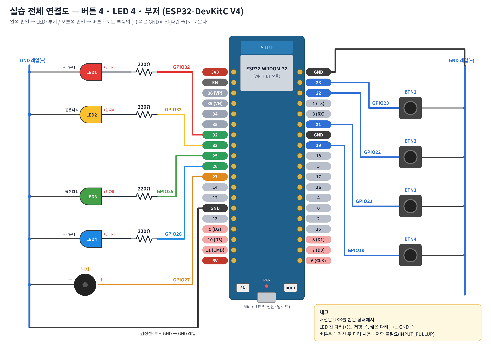

# 9주차 — 인공지능 학습 모델 준비하기 ① : ESP32 GPIO 제어 + 카메라 이미지 데이터 준비

| 구분 | 보드 | 내용 |
|---|---|---|
| 워크북 1 | **ESP32-DevKitC V4** (ESP32-WROOM-32) | GPIO 디지털 입·출력 — 버튼 4개, LED 4개, 부저 |
| 워크북 2 | **ESP32-S3-WROOM CAM** (Freenove 호환, 카메라·microSD 내장) | 카메라 촬영 → microSD JPEG 저장 → 이미지 갤러리 웹 앱 |
| 워크북 3 | Google Colab | 촬영 이미지 특성 확인 → 96×96 리사이즈 → 갤러리 앱(Gradio) → 라벨 폴더 정리 |

## 폴더 구성

```
week09_esp32_ai_image/
├─ part1_devkitc_gpio/        ESP32-DevKitC V4 (보드: "ESP32 Dev Module")
│   ├─ ex1_led_blink/          예제1  LED 4개 차례로 켜기            digitalWrite
│   ├─ ex2_button_read/        예제2  버튼 4개 상태 읽기              INPUT_PULLUP, digitalRead
│   ├─ ex3_button_led/         예제3  누르는 동안 LED 켜기
│   ├─ ex4_buzzer/             예제4  부저 도레미파                   tone
│   └─ ex5_smart_panel/        예제5  종합: 토글 + 효과음 + 채터링 제거 millis
├─ part2_s3_camera_sd/        ESP32-S3-WROOM CAM (보드: "ESP32S3 Dev Module", PSRAM: OPI PSRAM)
│   ├─ ex6_sd_test/            예제6  microSD 확인 (SD_MMC 1비트)
│   ├─ ex7_camera_capture_sd/  예제7  BOOT 버튼/시리얼 c → JPEG 촬영 → /photos/IMG_0001.jpg
│   └─ ex8_web_gallery/        예제8  Wi-Fi AP + 웹서버 갤러리 앱 (http://192.168.4.1)
├─ colab/
│   ├─ Week09_Workbook3_Image_Student.ipynb   학생용 (빈칸 3곳)
│   ├─ Week09_Workbook3_Image_Complete.ipynb  완성본
│   ├─ sample_images/ , sample_images.zip     320×240 샘플 6장 (정상 3, 어두움·너무 밝음·흐림 각 1)
├─ diagrams/                   회로도·연결도·개념도 (PNG + SVG 원본)
└─ archive_chatgpt_esp32cam/   이전 초안(AI Thinker ESP32-CAM 기준) 보관 — 사용 안 함
```

Colab에서 바로 열기:
- [학생용 워크북 3](https://colab.research.google.com/github/itlects/2026-1_ai-convergence-apply/blob/main/week09_esp32_ai_image/colab/Week09_Workbook3_Image_Student.ipynb)
- [완성본 워크북 3](https://colab.research.google.com/github/itlects/2026-1_ai-convergence-apply/blob/main/week09_esp32_ai_image/colab/Week09_Workbook3_Image_Complete.ipynb)

## 회로 연결 (DevKitC V4)

| 부품 | GPIO | 연결 |
|---|---|---|
| LED1~LED4 | 32, 33, 25, 26 | GPIO → 220Ω → LED 긴 다리(+) / 짧은 다리(−) → GND |
| BTN1~BTN4 | 23, 22, 21, 19 | GPIO → 택트 스위치 → GND (내부 풀업, 저항 없음) |
| 부저(수동) | 27 | GPIO → 부저(+) / 부저(−) → GND |



## ESP32-S3-WROOM CAM 내부 핀 (연결 불필요)

| 기능 | GPIO |
|---|---|
| 카메라 XCLK / SIOD / SIOC | 15 / 4 / 5 |
| VSYNC / HREF / PCLK | 6 / 7 / 13 |
| Y2~Y9 | 11, 9, 8, 10, 12, 18, 17, 16 |
| microSD CMD / CLK / D0 | 38 / 39 / 40 (1비트 SDMMC) |
| 촬영 버튼 | BOOT = GPIO0 |

다른 제조사 S3 카메라 보드는 스케치 상단 `#define` 핀 번호를 보드 설명서에 맞게 바꿉니다.

## Arduino IDE 준비

1. Arduino IDE 2.x 설치 → 파일 › 기본 설정 › 추가 보드 관리자 URL: `https://espressif.github.io/arduino-esp32/package_esp32_index.json`
2. 보드 매니저에서 **esp32 by Espressif Systems 3.x** 설치
3. USB 드라이버: DevKitC V4 = CP210x (Silicon Labs) / S3 CAM 보드 COM 포트 = CH343 (WCH)
4. 도구 메뉴

| 항목 | DevKitC V4 | ESP32-S3-WROOM CAM |
|---|---|---|
| 보드 | ESP32 Dev Module | ESP32S3 Dev Module |
| PSRAM | — | **OPI PSRAM** |
| Flash Size | 4MB | 8MB (N8R8) / 16MB (N16R8) |
| Partition Scheme | Default 4MB | 8M with spiffs (3MB APP/1.5MB SPIFFS) |
| USB CDC On Boot | — | COM(UART) 포트: Disabled / USB(OTG) 포트: Enabled |

## 검증 기록 (2026-11-04)

- arduino-esp32 **3.3.8** 코어 + arduino-cli 1.2.2로 8개 스케치 모두 컴파일 성공
  - ex1~ex5: `espressif:esp32:esp32` (21~22% 플래시)
  - ex6~ex8: `espressif:esp32:esp32s3:PSRAM=opi,FlashSize=8M,PartitionScheme=huge_app` (11~33%)
- Colab 워크북 완성본: 로컬 Jupyter에서 전체 셀 오류 없이 실행 (Gradio 앱은 Colab에서 `share=True`로 실행)
- **실물 보드 업로드·동작은 수업 전에 강의자가 1회 확인 필요** (특히 S3 보드 제조사별 카메라 핀·PSRAM 종류)
