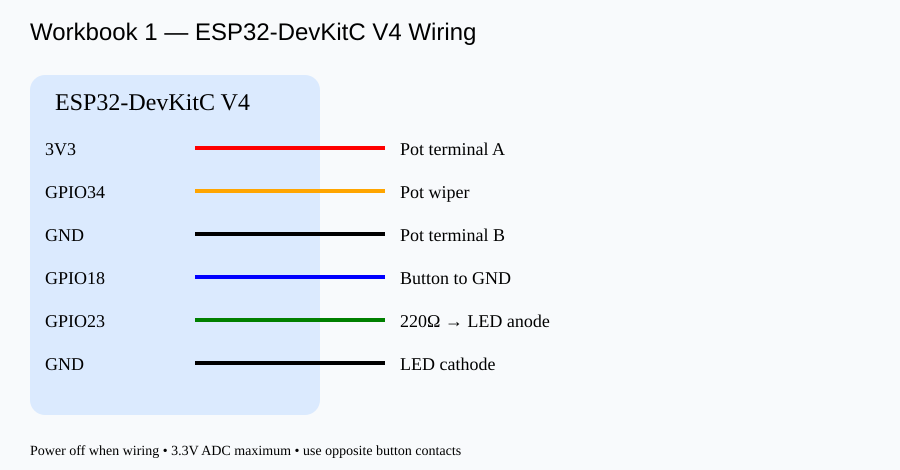

# Workbook 1 — Confidence threshold tuning

**Parts:** ESP32-DevKitC V4, 10k potentiometer, button, LED, 220Ω resistor, breadboard, USB cable.

**Wiring:** 3V3 → pot outer; GND → pot outer; pot middle → GPIO34 (ADC1). Button GPIO18 ↔ GND (INPUT_PULLUP). GPIO23 → 220Ω → LED anode; cathode → GND.

**Step 1:** Arduino IDE > ESP32 Dev Module > upload [counter_dial.ino](counter_dial.ino), 115200 baud.

**Step 2:** Turn dial; confirm THR lines. Press button; confirm TRIGGER count.

**Step 3:** Run `python workbook1/evaluate.py`. The dataset is [scores.csv](../data/scores.csv); no download during class.

**Step 4:** Close Serial Monitor, install pyserial if needed, run `python workbook1/serial_feed.py --port COM5` (adjust COM port) and observe RESULT and LED.

|Threshold|TP|FP|FN|TN|Precision|Recall|F1|
|---|---|---|---|---|---|---|---|
|0.30||||||||
|0.50||||||||
|0.70||||||||
|0.90||||||||

This exercise tunes a **decision threshold**, not learned neural-network weights. Simulated confidence records are independent events, not live camera detections. Evaluate FP/FN on the fixed CSV, not dynamic in-session dial changes.
