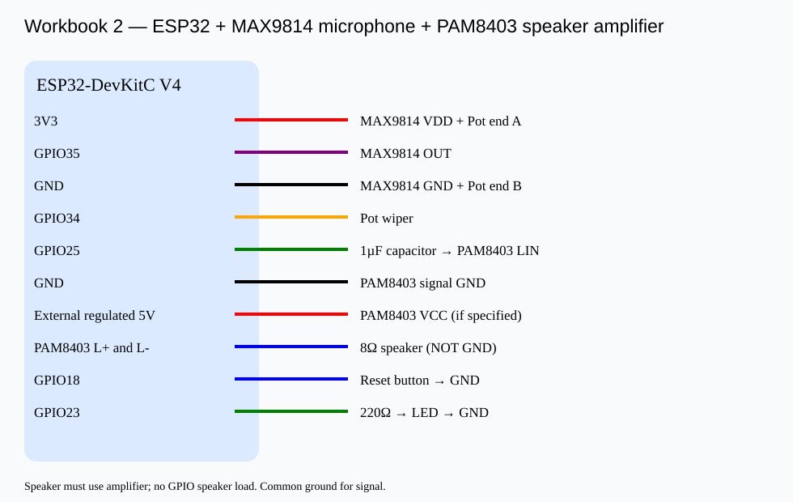

# Workbook 2 — Microphone + speaker sound-event counter

**Parts:** ESP32 DevKitC V4; MAX9814 analog mic; PAM8403 amplifier; 8Ω speaker; potentiometer 10k; reset button; LED and 220Ω resistor; 1µF AC coupling capacitor.

|Component|Wiring|
|---|---|
|Mic VDD, GND, OUT|3V3, GND, GPIO35|
|Pot left, wiper, right|3V3, GPIO34, GND|
|DAC GPIO25|1µF coupling capacitor → PAM8403 LIN|
|Amp GND|common GND|
|Amp VCC|regulated 5V if specified by module|
|Speaker|PAM8403 L+ and L- outputs, **not ESP32 GPIO/GND**|
|Reset button|GPIO18 / GND|
|LED|GPIO23 → 220Ω → LED → GND|

**Step 1:** Unplug USB and connect all wires; verify mic supply and amplifier datasheet.

**Step 2:** Upload [sound_counter.ino](sound_counter.ino) to classic ESP32 WROOM; open Serial Monitor at 115200.

**Step 3:** Clap 10 times at low/middle/high dial positions. Record EVENT count, false alarms and missed claps. RESET button clears count.

|Dial|Real claps|Counted|False alarms|Missed|
|---|---:|---:|---:|---:|
|Low|10||||
|Middle|10||||
|High|10||||

The microphone threshold is **peak-to-peak amplitude**, not trained AI confidence. A 600 ms cooldown prevents multiple counts for one clap. **Never connect a bare loudspeaker directly to ESP32 GPIO/DAC.**
